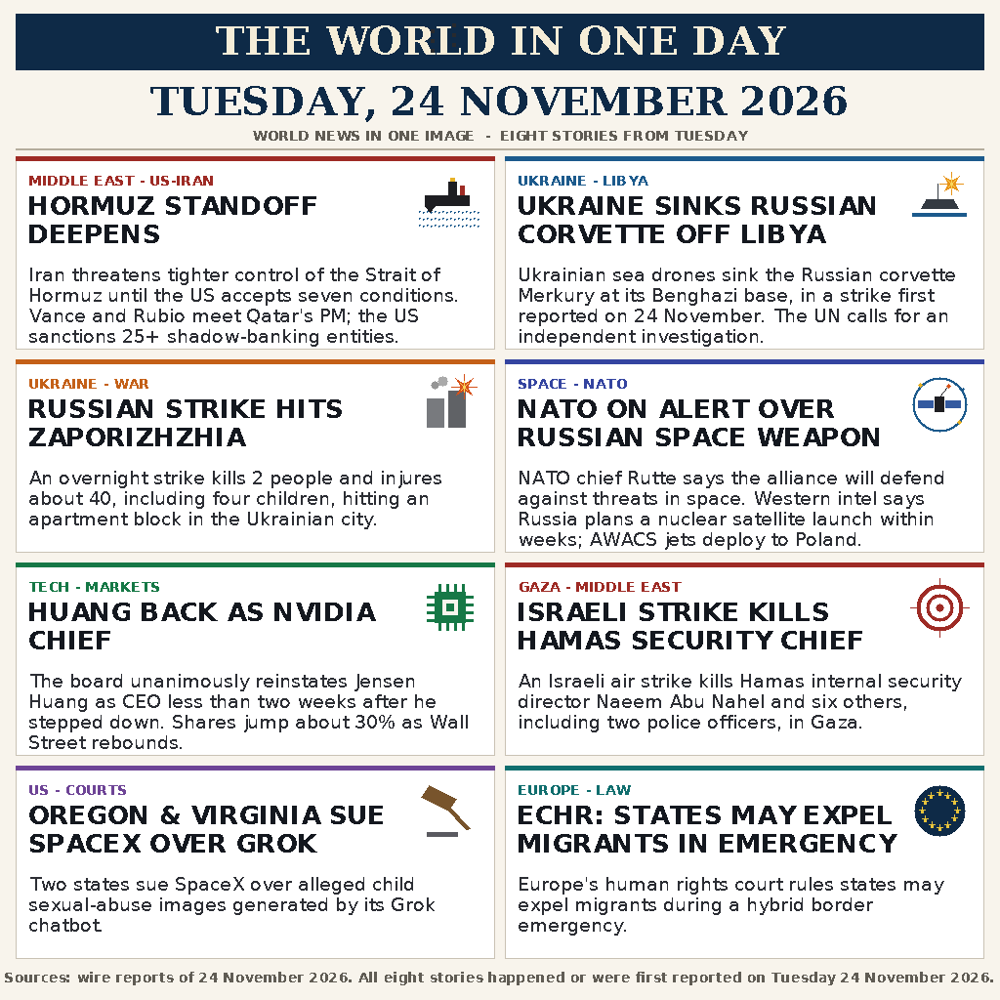

# The World in One Day — Tuesday 24 November 2026

[](https://make.fun/bounty/news-image-20261124)
[](https://make.fun/bounty/news-image-20261124)
[](https://make.fun/bounty/news-image-20261124)

Entry for the [make.fun bounty **news-image-20261124**](https://make.fun/bounty/news-image-20261124):
sum up 24 November's world news in one image.



## The image

A newspaper front page for **Tuesday, 24 November 2026**, with eight stories
from that day:

1. **Hormuz standoff deepens** — Iran threatens tighter control of the Strait
   of Hormuz; Vance and Rubio meet Qatar's PM; the US sanctions 25+
   shadow-banking entities.
2. **Ukraine sinks a Russian corvette off Libya** — sea drones sink the
   Merkury at Benghazi; the UN calls for an independent investigation.
3. **Russian strike hits Zaporizhzhia** — 2 killed, about 40 injured,
   including four children.
4. **NATO on alert over a Russian space weapon** — Rutte on defending space;
   Western intel on a planned nuclear satellite launch; AWACS jets to Poland.
5. **Huang back as NVIDIA chief** — board reinstates Jensen Huang; shares
   jump about 30%.
6. **Israeli strike kills Hamas security chief** — Naeem Abu Nahel and six
   others killed in Gaza.
7. **Oregon & Virginia sue SpaceX over Grok** — alleged child sexual-abuse
   images generated by the chatbot.
8. **ECHR: states may expel migrants in emergency** — European rights court
   rules on hybrid border emergencies.

## How it is built

`main.py` (Python 3.13, standard library only, no network) draws the whole
front page from scratch: a pixel canvas, a small bitmap font rendered from
the system DejaVu fonts into `fontdata.py`, hand-drawn emblems for each
story, and a hand-written PNG encoder (zlib). It writes `entry.png`
(1024×1024, deterministic — two runs produce byte-identical output).

```sh
python3 main.py        # writes entry.png in the current directory
```

`MAKEFUN_OUTPUT_DIR` (or `/output` when it exists) overrides the output
directory, as the grader expects.
